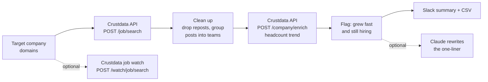

# Hiring Team Radar (Open Source, Slack Alerts for Recruiters)

**An open-source Python tool that finds which teams at your target companies are hiring fastest, using new engineering job posts plus each company's headcount trend, and posts a one-line summary per team to Slack every Monday.**

Teams that hire fast and keep hiring are where the people worth talking to are. Most recruiters only see a job post after it has been up for a week. This tool pulls the new engineering posts at your target companies, groups them into teams (AI & ML, Data, Security, Infrastructure, and so on), adds the company's headcount growth, and flags the teams that grew fast and are still hiring. [Crustdata](https://crustdata.com) is the job and company data layer ([API docs](https://docs.crustdata.com)).


## How it works



1. **Find the posts.** `POST /job/search` with your company domains (`company.basic_info.primary_domain in [...]`), title keywords (`job_details.title` contains `engineer` or `developer`) and a posted-since date (`metadata.date_added`). Newest first, cursor pagination.
2. **Clean up and group.** Drop reposted jobs, duplicate IDs and sales-side titles (solutions and sales engineers are not the engineering team you recruit from). Each remaining post goes into a team by title rules, then posts are grouped by company and team.
3. **Add the headcount trend.** One `POST /company/enrich` per 25 companies, by Crustdata company ID, asking only for `basic_info` and `headcount`. The tool reads `headcount.growth_percent` for the window you pick (`mom`, `qoq`, `six_months`, `yoy`).
4. **Flag.** A team is flagged when its company grew at least `MIN_GROWTH` percent over the window and the team has at least `MIN_POSTS` new posts. Each rule has a unit test.
5. **Summarise.** One line per flagged team. With `--summaries`, Claude rewrites the line from the same facts. It never chooses which teams are flagged.
6. **Alert.** Posts you have not seen before (`.state/seen.json`) go to Slack and `out/teams.csv`.

Headcount growth is company-wide, not per team. Treat it as the signal that the company is expanding, and the new posts as the signal of where.

## Quickstart

Requires Python 3.9+. No dependencies for the core tool.

```bash
git clone https://github.com/mhimed-crustdata/hiring-team-radar
cd hiring-team-radar
make setup        # creates .env, then add your CRUSTDATA_API_KEY
make demo         # runs the search and prints the summary, never posts to Slack
make run          # posts new flagged teams to SLACK_WEBHOOK_URL
make test         # unit tests, no network
```

Run it every Monday with cron (`0 8 * * 1 cd /path/to/repo && make run`) or a scheduled CI job with your keys stored as secrets.

## Configuration

All settings live in `.env` (copy from `.env.example`). Command-line flags override them.

| Variable | Default | What it does |
|---|---|---|
| `CRUSTDATA_API_KEY` | required | Your Crustdata API key. Read from the environment only |
| `COMPANIES` | `datadog.com,cloudflare.com,snowflake.com` | Target company domains |
| `KEYWORDS` | `engineer,developer` | Words a job title must contain |
| `SINCE_DAYS` | `7` | Posts added in the last N days |
| `GROWTH_WINDOW` | `qoq` | Headcount growth window: `mom`, `qoq`, `six_months`, `yoy` |
| `MIN_GROWTH` | `5` | Minimum company headcount growth (percent) to flag |
| `MIN_POSTS` | `2` | Minimum new posts in a team to flag |
| `EXCLUDE_TEAMS` | `Sales & Solutions Engineering` | Team names to drop. Empty keeps all |
| `SLACK_WEBHOOK_URL` | empty | Slack incoming webhook. Empty means no Slack post |
| `ANTHROPIC_API_KEY` | empty | Optional. With `--summaries`, Claude rewrites each flagged line |
| `ANTHROPIC_MODEL` | `claude-opus-5-5` | Model for the optional Claude step |

Useful flags: `--dry-run`, `--all` (include posts already alerted), `--max-jobs N`, `--out DIR`, `--create-watch`.

Examples for other roles:

```bash
python3 teams.py --keywords "designer,product manager" --companies "figma.com,notion.so"
python3 teams.py --window yoy --min-growth 20 --min-posts 3
```

To have Crustdata track new matching posts for you, `python3 teams.py --create-watch` creates a weekly job discovery watch (`POST /watch/job/search`) for the same filters. It is pull-only: read what it found with the watch runs API. Creating a watch commits your account to recurring per-record charges, so it only runs when you pass that flag.

Output files in `out/` are git-ignored.

## Example output

A real run on 2026-10-18 against the live API: six public software companies, engineering and developer titles, posts added in the last 7 days, 90-day (`qoq`) headcount growth, flag at 5 percent growth and 2 or more posts. Aggregated from `out/teams.json`:

```json
{
 "job_posts": 77,
 "companies": 5,
 "teams": 13,
 "flagged_teams": 3,
 "flagged_by_team": {"Software Engineering": 2, "Infrastructure & Platform": 1},
 "dropped": {"reposts": 7, "excluded_team": 12}
}
```

What the run showed:

- 77 new engineering posts across the six companies; 5 of the 6 had at least one. 7 were reposts and 12 were sales-side engineering roles, so 58 posts remained.
- Those 58 posts fell into 13 company-team groups. By team: Software Engineering 37, Infrastructure & Platform 8, AI & ML 8, Security 4, Data 1.
- Company headcount growth over the quarter ranged from flat to about 10 percent. Two companies cleared the 5 percent bar.
- 3 of 13 groups were flagged, covering 10 of the 58 posts. The largest single team had 15 new posts, which shows why the growth check matters: post volume alone does not say whether a company is expanding.

What the Slack summary looks like:

```text
:busts_in_silhouette: 3 teams to recruit from first (new engineering posts since 2026-10-11)
• [Company] Infrastructure & Platform: 4 new posts, company headcount +9.8% (qoq), 8,200 people.
• [Company] Software Engineering: 3 new posts, company headcount +7.1% (qoq), 5,100 people.
• [Company] Software Engineering: 3 new posts, company headcount +9.8% (qoq), 8,200 people.
```

(Illustrative layout with company names removed; the counts above are from the real run.)

## How to build a hiring-team radar

1. **Start from your target list.** Domains are the cleanest way to say which companies you mean, and `company.basic_info.primary_domain` is a job search filter.
2. **Ask for new posts only.** A posted-since filter on `metadata.date_added` keeps each weekly run small and cheap.
3. **Clean like a recruiter would.** Reposts and duplicates inflate a team's numbers. Sales-side engineer titles are a different talent pool.
4. **Group by team, not just company.** Three security posts and one backend post at the same company are two different conversations.
5. **Check the trend before you rank.** Enrich by company ID and read `headcount.growth_percent`. A burst of posts at a flat company is backfill; at a growing company it is expansion.
6. **Keep the rules in code.** Thresholds and team buckets are plain Python you can read and test. Use the model for the words, not the decision.
7. **Push it where recruiters work.** Slack for the Monday summary, CSV for the tracker. To get new posts pushed to you between runs, add a Crustdata job watch (see the [docs](https://docs.crustdata.com)).

## FAQ

**How do I track competitor hiring for recruiting?**
Search job postings for your target companies' domains, filtered to recent engineering titles, then group the posts by team and check each company's headcount growth. This tool does that with Crustdata's job search and company enrich endpoints and posts the result to Slack weekly.

**How does it decide a team grew fast?**
It reads the company's headcount growth for the window you choose (default: last quarter) and compares it to `MIN_GROWTH`. The growth is company-wide. The team's own signal is the number of new posts.

**How are teams assigned?**
By keyword rules on the job title (see `TEAM_RULES` in `teams.py`). Edit them to match how your recruiters think about teams.

**Why are solutions engineers dropped?**
They sit on the sales side. Set `EXCLUDE_TEAMS=""` to keep them.

**Can I use it for roles other than engineering?**
Yes. Set `KEYWORDS` (for example `designer,product manager`) and adjust `TEAM_RULES`.

**Does it contact anyone?**
No. It only posts to your own Slack webhook when `SLACK_WEBHOOK_URL` is set and `--dry-run` is off.

**Which Crustdata endpoints does it use?**
`POST /job/search` and `POST /company/enrich`, plus `POST /watch/job/search` when you pass `--create-watch`, on API version `2025-11-01`. See the [Crustdata API docs](https://docs.crustdata.com).

## Project layout

```text
teams.py            # the workflow: job search, grouping, headcount, flags, output
crustdata_api.py    # tiny Crustdata client (stdlib only)
notify.py           # optional Slack + Claude
tests/              # unit tests, no network
```

## License

MIT. See [LICENSE](LICENSE). Data layer: [Crustdata](https://crustdata.com) ([docs](https://docs.crustdata.com)).
